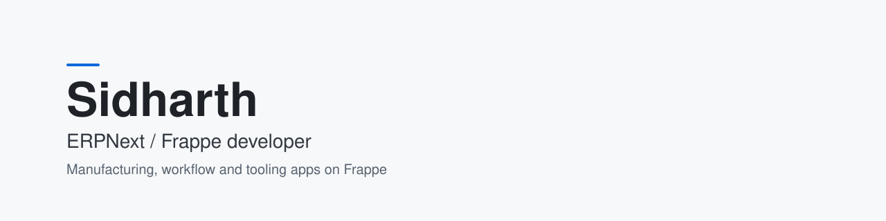

<picture>
  <source media="(prefers-color-scheme: dark)" srcset="assets/banner-dark.svg">
  
</picture>

## About

I build apps on the Frappe framework and open-source the parts other teams can reuse. My focus is manufacturing and workflow on ERPNext.

## Featured

### [floorgraph](https://github.com/s1dharthpv/floorgraph)

A governed action-graph MES layer for ERPNext: OEE, downtime tracking, finite-capacity scheduling and webhook-based machine events, with every change going through one approval and audit pipeline. Tested on ERPNext v15 and v16.

## Open source

| Project | What it does |
|---|---|
| [floorgraph](https://github.com/s1dharthpv/floorgraph) | Governed action-graph MES layer for ERPNext |
| [fieldbook](https://github.com/s1dharthpv/fieldbook) | Download an Excel spec sheet for any DocType, including custom fields |
| [macux-theme](https://github.com/s1dharthpv/macux-theme) | macOS-inspired GTK theme for Ubuntu 24.04, one-command install |

## Stack

Python, Frappe / ERPNext, JavaScript, TypeScript, MariaDB

## Links

- Portfolio: [sidharth-portfolio.vercel.app](https://sidharth-portfolio.vercel.app/)
